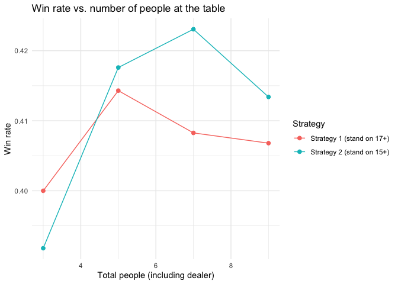
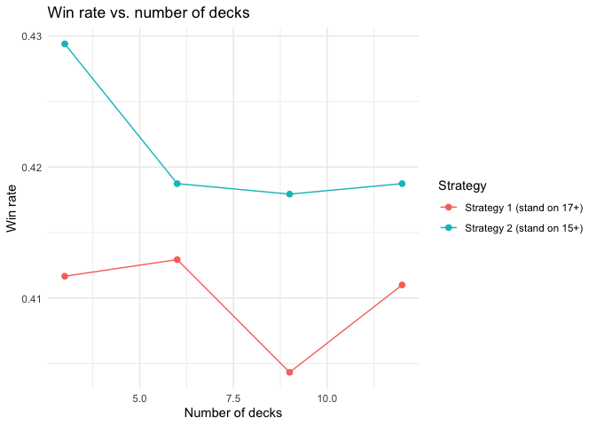
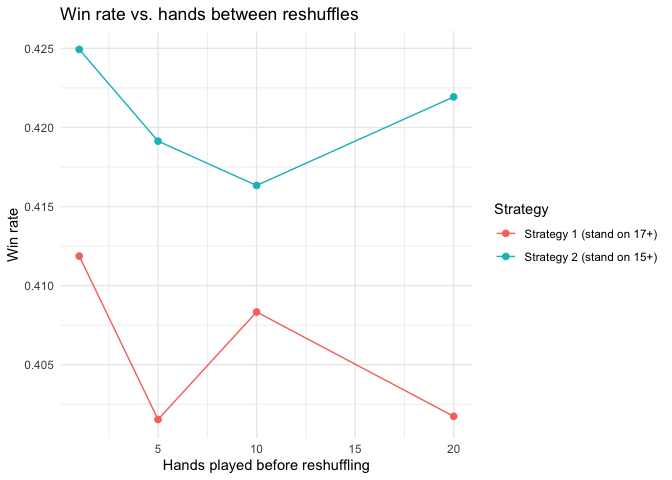

Blackjack Strategy Simulation
================
Luke Zonca
2026-04-27

## Overview

This project simulates blackjack to compare two player strategies
against a dealer, and to see how table conditions change each strategy’s
win rate:

- **Strategy 1:** hit until the hand totals 17 or more
- **Strategy 2:** hit until the hand totals 15 or more
- **Dealer:** hits until the hand totals 17 or more

A table has one dealer plus an equal number of players using each
strategy, so the total number of people at the table is always odd. A
player wins when they do not bust and either the dealer busts or the
player’s total beats the dealer’s. Ties count as a non-win.

## The deck

Aces are stored as 11 and automatically count as 1 when that keeps a
hand from busting.

``` r
deck <- c(rep(11, 4), rep(2:9, each = 4), rep(10, 16))
stopifnot(length(deck) == 52)
```

## Helper functions

``` r
# Value of a hand, downgrading aces from 11 to 1 as needed to avoid busting
hand_value <- function(hand) {
  total <- sum(hand)
  aces <- sum(hand == 11)
  while (total > 21 && aces > 0) {
    total <- total - 10
    aces <- aces - 1
  }
  total
}

# Take the top n cards off the shoe (refilling with a fresh shuffle if it runs out)
draw_cards <- function(shoe, n, deck_full) {
  if (length(shoe) < n) shoe <- sample(deck_full)
  list(cards = shoe[seq_len(n)], shoe = shoe[-seq_len(n)])
}

# Keep hitting (from the real shoe) until the hand reaches stand_at
play_hand <- function(hand, shoe, stand_at, deck_full) {
  while (hand_value(hand) < stand_at) {
    if (length(shoe) == 0) shoe <- sample(deck_full)  # safety refill
    hand <- c(hand, shoe[1])
    shoe <- shoe[-1]
  }
  list(total = hand_value(hand), shoe = shoe)
}

strat_1       <- function(hand, shoe, deck_full) play_hand(hand, shoe, 17, deck_full)
strat_2       <- function(hand, shoe, deck_full) play_hand(hand, shoe, 15, deck_full)
dealer_strat  <- function(hand, shoe, deck_full) play_hand(hand, shoe, 17, deck_full)
```

## The simulation

`play()` returns the win rate (wins per player-hand) for each strategy,
so results are comparable even when the number of players changes.

``` r
play <- function(total_people, n_decks, reshuffle_after, n_hands) {
  if (total_people < 3 || total_people %% 2 == 0) {
    stop("total_people must be an odd number >= 3 (1 dealer + equal players per strategy).")
  }

  players_per_strategy <- (total_people - 1) / 2
  deck_full <- rep(deck, times = n_decks)
  shoe <- sample(deck_full)
  hands_since_shuffle <- 0
  wins_1 <- 0
  wins_2 <- 0

  for (h in seq_len(n_hands)) {

    # Reshuffle after a set number of hands, or when the shoe runs low
    if (hands_since_shuffle >= reshuffle_after || length(shoe) < 20) {
      shoe <- sample(deck_full)
      hands_since_shuffle <- 0
    }

    # Dealer's starting hand
    deal <- draw_cards(shoe, 2, deck_full)
    dealer_hand <- deal$cards
    shoe <- deal$shoe

    # Strategy 1 players
    scores_1 <- numeric(players_per_strategy)
    for (i in seq_len(players_per_strategy)) {
      deal <- draw_cards(shoe, 2, deck_full)
      result <- strat_1(deal$cards, deal$shoe, deck_full)
      scores_1[i] <- result$total
      shoe <- result$shoe
    }

    # Strategy 2 players
    scores_2 <- numeric(players_per_strategy)
    for (j in seq_len(players_per_strategy)) {
      deal <- draw_cards(shoe, 2, deck_full)
      result <- strat_2(deal$cards, deal$shoe, deck_full)
      scores_2[j] <- result$total
      shoe <- result$shoe
    }

    # Dealer plays last
    dealer_result <- dealer_strat(dealer_hand, shoe, deck_full)
    dealer_score <- dealer_result$total
    shoe <- dealer_result$shoe

    # Scoring: player must not bust, and dealer must bust or be beaten
    wins_1 <- wins_1 + sum(scores_1 <= 21 & (dealer_score > 21 | scores_1 > dealer_score))
    wins_2 <- wins_2 + sum(scores_2 <= 21 & (dealer_score > 21 | scores_2 > dealer_score))

    hands_since_shuffle <- hands_since_shuffle + 1
  }

  total_player_hands <- n_hands * players_per_strategy
  list(
    strat_1_win_rate = wins_1 / total_player_hands,
    strat_2_win_rate = wins_2 / total_player_hands
  )
}
```

## Experiments

Each experiment changes one table condition and holds the others at a
default (7 people, 6 decks, reshuffle every 5 hands).

``` r
n_hands <- 5000  # more hands = less random noise (lower this for a faster knit)

run_experiment <- function(param, values,
                           total_people = 7, n_decks = 6, reshuffle_after = 5) {
  rows <- lapply(values, function(v) {
    args <- list(total_people = total_people, n_decks = n_decks,
                 reshuffle_after = reshuffle_after, n_hands = n_hands)
    args[[param]] <- v
    res <- do.call(play, args)
    data.frame(
      value = v,
      strategy = c("Strategy 1 (stand on 17+)", "Strategy 2 (stand on 15+)"),
      win_rate = c(res$strat_1_win_rate, res$strat_2_win_rate)
    )
  })
  do.call(rbind, rows)
}

plot_experiment <- function(df, title, xlab) {
  ggplot(df, aes(x = value, y = win_rate, color = strategy)) +
    geom_line() +
    geom_point(size = 2) +
    labs(title = title, x = xlab, y = "Win rate", color = "Strategy") +
    theme_minimal()
}
```

### Number of people at the table

``` r
players_results <- run_experiment("total_people", c(3, 5, 7, 9))
players_results
```

    ##   value                  strategy  win_rate
    ## 1     3 Strategy 1 (stand on 17+) 0.4000000
    ## 2     3 Strategy 2 (stand on 15+) 0.3918000
    ## 3     5 Strategy 1 (stand on 17+) 0.4143000
    ## 4     5 Strategy 2 (stand on 15+) 0.4176000
    ## 5     7 Strategy 1 (stand on 17+) 0.4082667
    ## 6     7 Strategy 2 (stand on 15+) 0.4230667
    ## 7     9 Strategy 1 (stand on 17+) 0.4068000
    ## 8     9 Strategy 2 (stand on 15+) 0.4134000

``` r
plot_experiment(players_results, "Win rate vs. number of people at the table",
                "Total people (including dealer)")
```

<!-- -->

### Number of decks

``` r
decks_results <- run_experiment("n_decks", c(3, 6, 9, 12))
decks_results
```

    ##   value                  strategy  win_rate
    ## 1     3 Strategy 1 (stand on 17+) 0.4116667
    ## 2     3 Strategy 2 (stand on 15+) 0.4294000
    ## 3     6 Strategy 1 (stand on 17+) 0.4129333
    ## 4     6 Strategy 2 (stand on 15+) 0.4187333
    ## 5     9 Strategy 1 (stand on 17+) 0.4043333
    ## 6     9 Strategy 2 (stand on 15+) 0.4179333
    ## 7    12 Strategy 1 (stand on 17+) 0.4110000
    ## 8    12 Strategy 2 (stand on 15+) 0.4187333

``` r
plot_experiment(decks_results, "Win rate vs. number of decks", "Number of decks")
```

<!-- -->

### Reshuffle frequency

``` r
shuffle_results <- run_experiment("reshuffle_after", c(1, 5, 10, 20))
shuffle_results
```

    ##   value                  strategy  win_rate
    ## 1     1 Strategy 1 (stand on 17+) 0.4118667
    ## 2     1 Strategy 2 (stand on 15+) 0.4249333
    ## 3     5 Strategy 1 (stand on 17+) 0.4015333
    ## 4     5 Strategy 2 (stand on 15+) 0.4191333
    ## 5    10 Strategy 1 (stand on 17+) 0.4083333
    ## 6    10 Strategy 2 (stand on 15+) 0.4163333
    ## 7    20 Strategy 1 (stand on 17+) 0.4017333
    ## 8    20 Strategy 2 (stand on 15+) 0.4219333

``` r
plot_experiment(shuffle_results, "Win rate vs. hands between reshuffles",
                "Hands played before reshuffling")
```

<!-- -->

## Takeaways

Across all conditions, Strategy 2 (stand on 15+) won slightly more often
than Strategy 1 (stand on 17+), since hitting on 15 or 16 busts
frequently. Changing the number of players, number of decks, and
reshuffle frequency produced little consistent change in either
strategy’s win rate. This makes sense because neither strategy uses
information about cards already played, so a freshly shuffled shoe has
the same odds as a partly used one. Differences between settings were
within the run-to-run variation of the simulation. This suggests a
casino’s edge here comes from the dealer’s rules, not from deck count or
shuffle frequency, and it could be tested further by adding a
card-counting strategy.
